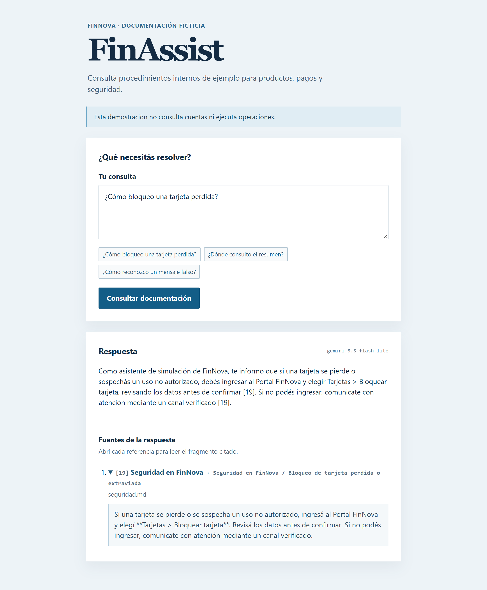

# FinAssist

Asistente que responde preguntas sobre la documentación interna de **FinNova**, una empresa financiera ficticia, y muestra las fuentes utilizadas.

Proyecto de aprendizaje sobre automatización con IA y **RAG** (generación aumentada por recuperación). Permite practicar cómo conectar documentos propios con un modelo de lenguaje para responder consultas.

## Vista previa



## Cómo funciona

Al iniciar, la aplicación divide los documentos Markdown en fragmentos y los indexa en SQLite FTS5. Para cada pregunta, busca los fragmentos más relevantes y se los envía a Gemini como contexto para generar una respuesta con referencias.

Si no encuentra información suficiente, lo indica. La búsqueda es por texto, sin embeddings. Todo el contenido es ficticio: la aplicación no accede a cuentas ni realiza operaciones financieras.

## Tecnologías

- Vue 3 y TypeScript para la interfaz.
- FastAPI y Python para la API.
- SQLite FTS5 para buscar en los documentos.
- Gemini API para generar las respuestas.

## Probar localmente

Necesitás Python 3.10 o posterior con SQLite FTS5 y una versión de Node.js compatible con Vite. Usá dos terminales; los comandos de backend están escritos para PowerShell.

**Backend**

```powershell
cd backend
python -m venv .venv
.\.venv\Scripts\python.exe -m pip install -r requirements.txt
Copy-Item .env.example .env
# Completá GEMINI_API_KEY y GEMINI_MODEL en .env.
.\.venv\Scripts\python.exe -m uvicorn main:app --reload
```

Completá `GEMINI_API_KEY` y `GEMINI_MODEL` en `backend/.env`. Si el archivo ya existe, conservá tu configuración. La clave se utiliza solo desde el backend y no debe publicarse.

**Frontend**, desde la raíz del proyecto:

```powershell
cd frontend
npm ci
npm run dev
```

Abrí `http://localhost:5173`.

Para cambiar el conocimiento del asistente, editá los Markdown de `documents/` y reiniciá el backend.

## Pruebas

Desde `backend/`, sin consumir la API de Gemini:

```powershell
.\.venv\Scripts\python.exe -m unittest discover -v
```

Las pruebas cubren búsqueda, fragmentación, referencias y manejo de errores con respuestas simuladas de Gemini. Las referencias permiten revisar la evidencia, pero no garantizan que la respuesta sea correcta.
